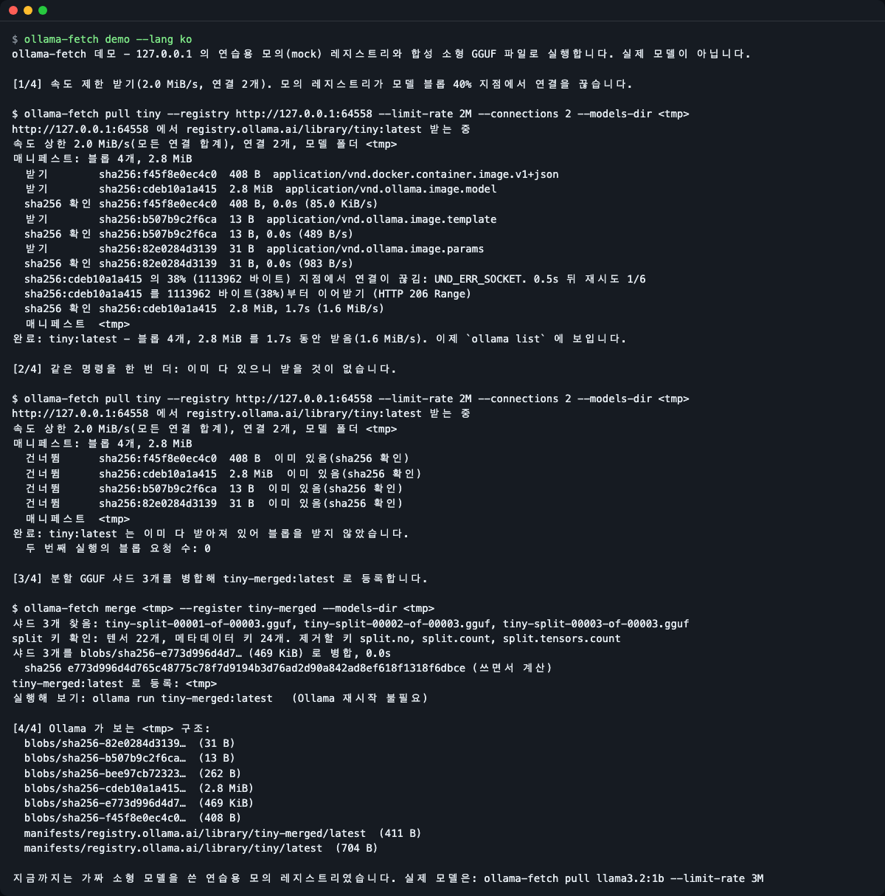
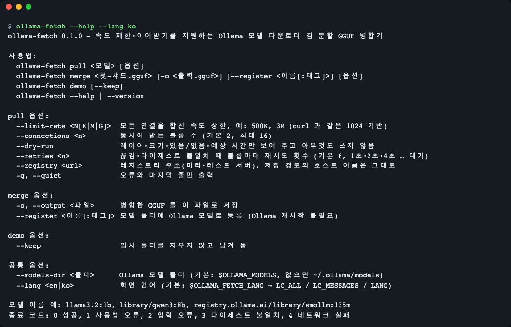
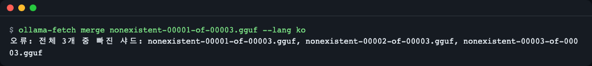
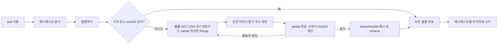

# ollama-fetch

[English](README.md) | **한국어**

속도 제한·이어받기·무결성 검사를 지원하는 Ollama 모델 다운로더입니다. Ollama 모델 폴더에 바로 저장하고, 분할된 GGUF 파일(Hugging Face 의 `-00001-of-00003.gguf` 같은 샤드)을 하나로 병합해 `ollama list` 에 보이게 할 수도 있습니다. `ollama pull` 이 회선을 다 차지하거나 받다가 자꾸 끊길 때 쓰세요. 바로 해 보기: `git clone https://github.com/LeeGyeongPil/ollama-fetch && cd ollama-fetch && npm ci && npm run demo`.


*내장 데모: 모의 레지스트리가 연결을 끊으면 HTTP Range 요청으로 이어받고, SHA-256 검사를 통과하며, 분할 샤드 3개를 병합·등록합니다.*

## 이런 분께
- 사무실·집 회선을 같이 쓰고, 화상회의 중에도 모델 다운로드를 예를 들어 3 MiB/s 이하로 묶고 싶은 분
- 회선이 끊겨도 같은 바이트부터 이어받고, 파일이 온전하다는 증거(해시)가 필요한 분
- Hugging Face 에서 받은 분할 GGUF 를 llama.cpp 빌드 없이 Ollama 모델 하나로 만들고 싶은 분 ([ollama/ollama#2006](https://github.com/ollama/ollama/issues/2006), [#5245](https://github.com/ollama/ollama/issues/5245))

## 설치
Node.js 20 이상이 필요합니다(macOS: `brew install node`, 그 밖에는 [nodejs.org](https://nodejs.org/)). 실행 시 의존 패키지는 없습니다. 클론해서 설치합니다.

```bash
git clone https://github.com/LeeGyeongPil/ollama-fetch
cd ollama-fetch
npm ci          # TypeScript 와 @types/node 설치(개발용)
npm run build   # dist/ 로 컴파일(npm run demo, npm test 도 알아서 컴파일)
```

아래 예시는 `ollama-fetch ...` 로 적습니다. 클론 폴더에서는 같은 명령이 `node dist/src/cli.js ...` 입니다. 클론에서 `npm link` 를 하면(또는 게시된 패키지를 설치하면) 전역 `ollama-fetch` 명령이 생깁니다.

## 빠르게 시작하기
먼저 연습용 모의(mock) 모드로 해 보세요. 네트워크도 실제 모델도 필요 없습니다.

```bash
npm run demo -- --lang ko
```

데모는 `127.0.0.1` 에 작은 레지스트리를 띄우고 합성 소형 GGUF 를 내려주며, 40% 지점에서 끊고 이어받고, 같은 pull 을 다시 돌려(다운로드 0회) 보여 준 뒤 샤드 3개를 병합합니다. 파일은 임시 폴더에 만들어지고 끝나면 지워집니다(`--keep` 이면 남깁니다). 출력은 위 스크린샷이고, 가운데 부분은 이렇습니다.

```
  sha256:cdeb10a1a415 의 38% (1113962 바이트) 지점에서 연결이 끊김: UND_ERR_SOCKET. 0.5s 뒤 재시도 1/6
  sha256:cdeb10a1a415 를 1113962 바이트(38%)부터 이어받기 (HTTP 206 Range)
  sha256 확인 sha256:cdeb10a1a415  2.8 MiB, 1.7s (1.6 MiB/s)
```

- `38% (...) 지점에서 연결이 끊김`: 모의 레지스트리가 연결을 끊었습니다. 38% 는 실제로 디스크에 쓴 양입니다(서버는 40% 를 보냈지만 읽지 못한 끝부분은 연결과 함께 버려집니다).
- `1113962 바이트(38%)부터 이어받기 (HTTP 206 Range)`: 클라이언트가 `Range: bytes=1113962-` 를 보내고 서버가 "부분 내용"(206)으로 답했습니다.
- `sha256 확인`: 다 받은 파일의 해시가 저장 이름과 같으므로, 레지스트리가 올린 그 파일입니다.

모의 모드는 연습용입니다. 로컬 가짜 레지스트리와 가짜 소형 모델이며 실제가 아닙니다. 실제 pull 은 `registry.ollama.ai` 와 통신하므로 회선 속도와 공유 CDN 부하에 따라 더 느릴 수 있습니다.

실제 모델:

```bash
ollama-fetch pull llama3.2:1b --limit-rate 3M
```

> 실제 레지스트리 pull 은 빌드 환경에서 확인하지 못했습니다(`registry.ollama.ai` 접속이 막혀 있었습니다). 프로토콜 단계는 공개된 레지스트리 구조를 따르고 모의 레지스트리로 테스트했습니다. Hugging Face 샤드의 실제 병합은 확인했고 Ollama 가 정상 로드했습니다. 다른 점이 있으면 알려 주세요.

## 사용법


*`ollama-fetch --help`: 명령 3개와 옵션.*

| 명령·옵션 | 하는 일 | 예 |
|---|---|---|
| `pull <모델>` | 레지스트리에서 모델을 받아 모델 폴더에 저장 | `ollama-fetch pull llama3.2:1b` |
| `--limit-rate <N[K\|M\|G]>` | 모든 연결을 합친 속도 상한(curl 처럼 1024 기반, `500K`·`3M`·`1.5M`·`3MiB/s` 가능) | `--limit-rate 3M` |
| `--connections <n>` | 동시에 받을 블롭 수(기본 2, 최대 16) | `--connections 3` |
| `--retries <n>` | 끊김·해시 불일치 뒤 재시도 횟수(기본 6, 대기 1초·2초·4초…최대 30초) | `--retries 10` |
| `--dry-run` | 레이어·크기·있음/없음·예상 시간만 보여 주고 아무것도 쓰지 않음 | `pull tiny --dry-run --limit-rate 2M` |
| `--registry <url>` | 미러·테스트 서버 주소(저장되는 호스트 이름은 `registry.ollama.ai` 그대로) | `--registry http://127.0.0.1:8080` |
| `-q`, `--quiet` | 오류와 마지막 줄만 출력 | `-q` |
| `merge <첫-샤드>` | 분할 GGUF 샤드를 한 파일로 병합 | `ollama-fetch merge m-00001-of-00003.gguf` |
| `-o`, `--output <파일>` | 병합 결과 파일 위치(기본: 같은 폴더의 `m.gguf`) | `-o model.gguf` |
| `--register <이름[:태그]>` | 병합 결과를 모델 폴더에 등록해 Ollama 가 보게 함 | `--register my-model` |
| `demo [--keep]` | 모의 레지스트리로 하는 오프라인 연습 실행 | `ollama-fetch demo` |
| `--models-dir <폴더>` | 모델 폴더(기본 `$OLLAMA_MODELS`, 없으면 `~/.ollama/models`) | `--models-dir /data/ollama` |
| `--lang <en\|ko>` | 화면 언어 | `--lang ko` |

종료 코드: `0` 성공, `1` 사용법 오류, `2` 입력 문제(GGUF 아님·샤드 빠짐·모델 이름 형식·쓰기 권한), `3` 해시 불일치, `4` 네트워크 실패, `130` 중단(partial 파일을 남기므로 다시 실행하면 이어받음).

### 받기 전에 미리 보기
`--dry-run` 은 레지스트리(여기서는 `ollama-fetch demo` 가 띄우는 로컬 모의 레지스트리, 직접 쓸 때는 `--registry <url>`)의 레이어를 나열하고 상한 기준 예상 시간을 계산합니다(`--lang ko` 출력).

```
모델        registry.ollama.ai/library/tiny:latest
레지스트리  http://127.0.0.1:63926
모델 폴더   /tmp/…/of-sample-B02o7h

미디어 타입                                     크기     상태  다이제스트
application/vnd.docker.container.image.v1+json  408 B    없음  sha256:f45f8e0ec4c0
application/vnd.ollama.image.model              2.8 MiB  없음  sha256:cdeb10a1a415
application/vnd.ollama.image.template           13 B     없음  sha256:b507b9c2f6ca
application/vnd.ollama.image.params             31 B     없음  sha256:82e0284d3139

합계 2.8 MiB, 블롭 4개. 받을 양 2.8 MiB (없는 블롭 4개)
2.0 MiB/s 기준 예상 시간: 2s
미리 보기라 아무것도 쓰지 않았습니다.
```

### 분할 GGUF 병합
샤드를 한 폴더에 모아 두고 첫 번째 파일을 지정합니다.

```bash
ollama-fetch merge model-00001-of-00003.gguf --register my-model
ollama run my-model
```

샤드가 모두 있는지, `split.*` 메타데이터가 서로 맞는지 확인한 뒤 SHA-256 을 계산하며 하나의 GGUF 로 쓰고, `blobs/sha256-<해시>` 로 저장하고 Ollama 매니페스트를 만듭니다. 샤드가 빠지면 아무것도 쓰지 않습니다.


*빠진 샤드를 이름으로 알려 주고 종료 코드 2 로 끝납니다. 출력 파일은 남지 않습니다.*

## 설정

| 변수 | 뜻 |
|---|---|
| `OLLAMA_MODELS` | Ollama 모델 폴더(기본 `~/.ollama/models`), `--models-dir` 이 우선 |
| `OLLAMA_FETCH_LANG` | 화면 언어 `en` 또는 `ko`. `--lang` 이 우선이고, 그다음 `LC_ALL`·`LC_MESSAGES`·`LANG` 을 봅니다(`ko` 로 시작하면 한국어, 아니면 영어) |
| `HTTPS_PROXY` | 프록시. Node 의 `fetch` 는 `NODE_USE_ENV_PROXY=1`(Node 24+)이 없으면 무시하며, CLI 가 안내를 출력합니다 |
| `OLLAMA_FETCH_E2E` | `1` 이면 `npm test` 에 선택 사항인 실제 네트워크 테스트를 포함 |

API 키·토큰은 읽거나 쓰지 않습니다. 익명 공개 다운로드만 합니다.

## 동작 원리



- 모델은 *블롭*(SHA-256 다이제스트 이름의 파일) 목록을 담은 작은 JSON *매니페스트* 입니다. 매니페스트를 먼저 받습니다.
- 토큰 버킷 하나를 모든 연결이 공유해 합계 속도를 제한합니다. 디스크에 쓰기 전에 토큰을 기다리므로 TCP 흐름 제어가 실제 회선 사용량을 낮춥니다.
- 블롭은 `<blob>.ollama-fetch.partial` 로 씁니다. 끊기면 재시도가 `Range: bytes=<크기>-` 를 보냅니다. 서버가 Range 를 무시하면(200 응답) partial 을 버리고 처음부터 받습니다. 재시도마다 블롭 URL 부터 다시 시작하므로 만료된 CDN 주소를 재사용하지 않습니다.
- 해시가 맞으면 제자리로 rename 합니다. 매니페스트는 마지막에 쓰므로 Ollama 는 반쪽 모델을 보지 않습니다.
- `merge` 는 각 샤드의 GGUF 헤더(메타데이터·텐서 표)를 읽고 `split.*` 키를 지우며 필요하면 텐서 데이터를 다시 정렬해 한 파일로 이어 씁니다.

## 언제 쓰나
- 잘 맞는 경우: 속도가 제한되거나 불안정한 회선, 해시로 확인하는 반복 가능한 pull, 이미 받은 분할 GGUF 병합.
- 다른 도구: 빠르고 단순한 pull 은 [`ollama pull`](https://github.com/ollama/ollama), llama.cpp 소스에서 병합 파일을 만들 때는 [llama.cpp 의 `llama-gguf-split`](https://github.com/ggml-org/llama.cpp).

## 자주 겪는 문제

| 증상 | 원인 | 해결 |
|---|---|---|
| `error: invalid model name ...` (종료 2) | 이름이 `name[:tag]`·`ns/name:tag`·`host/ns/name:tag` 형식이 아님 | `llama3.2:1b` 처럼 쓰기 |
| `error: invalid --limit-rate 'abc'` (종료 1) | 알 수 없는 속도 형식 | `500K`·`3M`·`1G` 사용 |
| `missing shard(s) of 3 ...` (종료 2) | 샤드가 한 폴더에 다 있지 않음 | 나머지를 받고 원래 파일 이름 유지 |
| 종료 3 | 받은 바이트가 끝내 다이제스트와 맞지 않음 | 다시 실행, 디스크·미러 확인 |
| 종료 4 | 진전 없이 연결이 계속 실패 | 다시 실행하면 partial 에서 이어받음 |
| 프록시 뒤에서 레지스트리에 못 닿음 | Node `fetch` 가 `HTTPS_PROXY` 를 무시 | `NODE_USE_ENV_PROXY=1 ollama-fetch pull ...` (Node 24+) |
| 큰 모델을 다시 실행하면 시작이 느림 | 실행마다 기존 블롭을 다시 해시함(GB 당 몇 초) | 정상입니다. 확인이 끝날 때까지 기다리세요 |
| 같은 모델을 동시에 두 번 pull 하면 낭비 | 프로세스 간 잠금이 없음 | 모델당 한 번에 하나만 실행하세요 |
| `ollama list` 에 모델이 안 보임 | 모델 폴더가 다름 | 서버의 `OLLAMA_MODELS` 와 같은 값을 `--models-dir` 로 지정 |

## 개발·기여

```bash
npm test
```

테스트는 실제 로컬 HTTP 모의 레지스트리와 합성 GGUF 로 돌고, 장애(끊김·멈춤·Range 무시·손상 바이트)를 주입합니다. 버그·제안은 이슈로 남겨 주세요. 변경 기록은 [CHANGELOG.md](CHANGELOG.md).

## 라이선스
MIT. 데모는 합성 데이터만 쓰며 모델 파일은 포함하지 않습니다.
