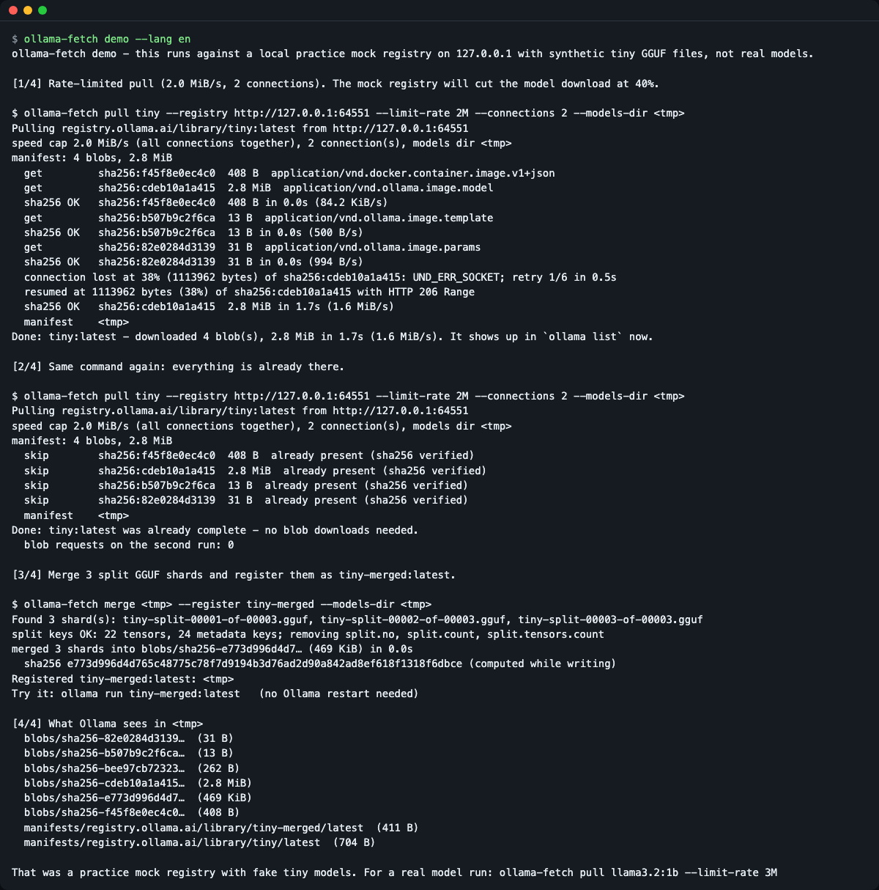
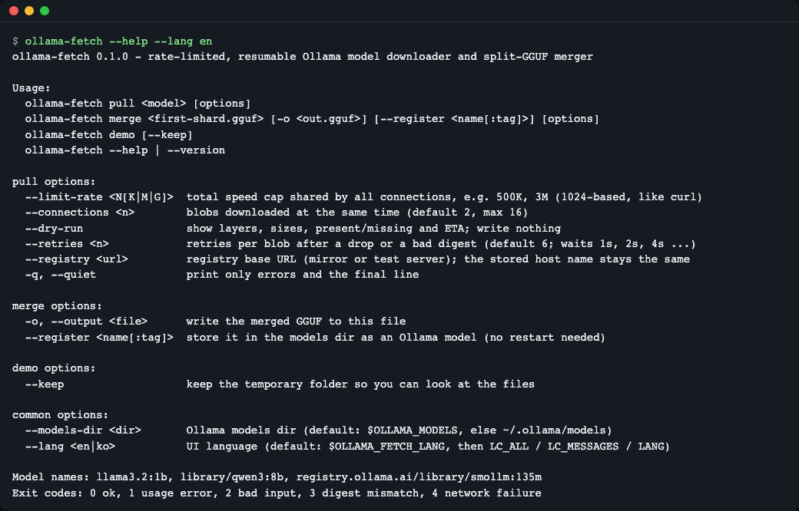
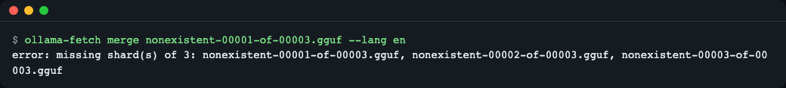
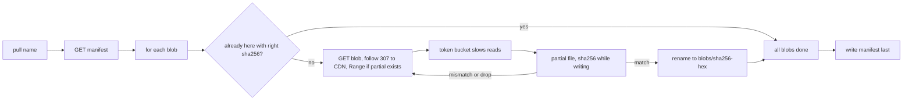

# ollama-fetch

**English** | [한국어](README.ko.md)

A rate-limited, resumable, digest-verified downloader for Ollama models. It writes straight into your Ollama models folder, and it can also merge split GGUF shards (the `-00001-of-00003.gguf` files from Hugging Face) into one model that `ollama list` shows. Use it when `ollama pull` would eat your whole connection, or when a download keeps dying halfway. Try it with `git clone https://github.com/LeeGyeongPil/ollama-fetch && cd ollama-fetch && npm ci && npm run demo`.


*The built-in demo: a capped download is cut off by the mock registry, resumes with an HTTP Range request, passes the SHA-256 check, and three split shards are merged and registered.*

## Who is this for
- You share an office or home connection and want a model download to stay under, say, 3 MiB/s during video calls.
- Your connection drops and you want to continue from the same byte, with proof that the file is intact.
- You already downloaded split GGUF shards from Hugging Face and want one Ollama model without building llama.cpp ([ollama/ollama#2006](https://github.com/ollama/ollama/issues/2006), [#5245](https://github.com/ollama/ollama/issues/5245)).

## Install
Requires Node.js 20 or newer (`brew install node` on macOS, or see [nodejs.org](https://nodejs.org/)). It has no runtime dependencies. Install it from the clone:

```bash
git clone https://github.com/LeeGyeongPil/ollama-fetch
cd ollama-fetch
npm ci          # installs TypeScript and @types/node (dev only)
npm run build   # compiles to dist/ (npm run demo and npm test also do this)
```

The examples below write `ollama-fetch ...`. From the clone, the same command is `node dist/src/cli.js ...`. A global `ollama-fetch` command appears once you run `npm link` in the clone (or install the published package).

## Quick start
First try the practice (mock) mode. It needs no network and no real model:

```bash
npm run demo -- --lang en
```

The demo starts a small registry on `127.0.0.1`, serves synthetic tiny GGUF files, cuts the download at 40%, resumes it, runs the same pull again (zero downloads), then merges three shards. Everything lands in a temporary folder that is deleted at the end (`--keep` keeps it). The output is the screenshot above; its middle part looks like this:

```
  connection lost at 38% (1113962 bytes) of sha256:cdeb10a1a415: UND_ERR_SOCKET; retry 1/6 in 0.5s
  resumed at 1113962 bytes (38%) of sha256:cdeb10a1a415 with HTTP 206 Range
  sha256 OK   sha256:cdeb10a1a415  2.8 MiB in 1.7s (1.6 MiB/s)
```

- `connection lost at 38%`: the mock registry cut the connection. 38% is what was really written to disk (the server had sent 40%; the unread tail was dropped by the connection).
- `resumed at 1113962 bytes ... HTTP 206`: the client asked for `Range: bytes=1113962-` and the server answered "partial content".
- `sha256 OK`: the finished file hashes to the name it is stored under, so it is the file the registry published.

The mock mode is a practice setup: a local fake registry and fake tiny models, not real ones. A real pull talks to `registry.ollama.ai`, depends on your line speed and shared CDN load, and can be slower.

For a real model:

```bash
ollama-fetch pull llama3.2:1b --limit-rate 3M
```

> The real-registry pull has not been verified from the build environment (`registry.ollama.ai` was blocked there). The protocol steps follow the public registry layout and are tested against the mock registry. A real merge of Hugging Face shards was checked and loaded by Ollama. Please report anything that differs.

## Usage


*`ollama-fetch --help`: three commands and their options.*

| Command / option | What it does | Example |
|---|---|---|
| `pull <model>` | Download a model from the registry into the models folder | `ollama-fetch pull llama3.2:1b` |
| `--limit-rate <N[K\|M\|G]>` | Total speed cap shared by all connections (1024-based like curl; `500K`, `3M`, `1.5M`, `3MiB/s` work) | `--limit-rate 3M` |
| `--connections <n>` | Blobs downloaded at the same time (default 2, max 16) | `--connections 3` |
| `--retries <n>` | Retries after a drop or bad digest (default 6, waits 1 s, 2 s, 4 s ... up to 30 s) | `--retries 10` |
| `--dry-run` | Show layers, sizes, present/missing and the time estimate; write nothing | `pull tiny --dry-run --limit-rate 2M` |
| `--registry <url>` | Mirror or test server; the stored host name stays `registry.ollama.ai` | `--registry http://127.0.0.1:8080` |
| `-q`, `--quiet` | Print only errors and the final line | `-q` |
| `merge <first-shard>` | Merge split GGUF shards into one file | `ollama-fetch merge m-00001-of-00003.gguf` |
| `-o`, `--output <file>` | Where to write the merged file (default: same folder, `m.gguf`) | `-o model.gguf` |
| `--register <name[:tag]>` | Store the merged model in the models folder so Ollama sees it | `--register my-model` |
| `demo [--keep]` | Offline practice run on a mock registry | `ollama-fetch demo` |
| `--models-dir <dir>` | Models folder (default `$OLLAMA_MODELS`, else `~/.ollama/models`) | `--models-dir /data/ollama` |
| `--lang <en\|ko>` | Screen language | `--lang ko` |

Exit codes: `0` ok, `1` usage error, `2` bad input (not a GGUF, missing shard, bad model name, no write permission), `3` digest mismatch, `4` network failure, `130` interrupted (the partial file is kept, run again to resume).

### Preview before downloading
Against a registry (here the demo's local mock one, started by `ollama-fetch demo`; for yours, pass `--registry <url>`) `--dry-run` lists every layer and estimates the time at your cap:

```
Model       registry.ollama.ai/library/tiny:latest
Registry    http://127.0.0.1:63926
Models dir  /tmp/.../of-sample-B02o7h

MEDIA TYPE                                      SIZE     STATUS   DIGEST
application/vnd.docker.container.image.v1+json  408 B    missing  sha256:f45f8e0ec4c0
application/vnd.ollama.image.model              2.8 MiB  missing  sha256:cdeb10a1a415
application/vnd.ollama.image.template           13 B     missing  sha256:b507b9c2f6ca
application/vnd.ollama.image.params             31 B     missing  sha256:82e0284d3139

Total 2.8 MiB in 4 blobs; to download 2.8 MiB (4 missing)
Estimated time at 2.0 MiB/s: 2s
Dry run: nothing was written.
```

### Merge split GGUF shards
Put all shards in one folder, then point at the first one:

```bash
ollama-fetch merge model-00001-of-00003.gguf --register my-model
ollama run my-model
```

It checks that every shard is there and that the `split.*` metadata agrees, writes one GGUF while computing its SHA-256, stores it as `blobs/sha256-<hash>` and writes an Ollama manifest. If a shard is missing nothing is written:


*A missing shard is reported by name and exits with code 2; no output file is left.*

## Settings

| Variable | Meaning |
|---|---|
| `OLLAMA_MODELS` | Ollama models folder (default `~/.ollama/models`); `--models-dir` overrides |
| `OLLAMA_FETCH_LANG` | Screen language `en` or `ko`; `--lang` overrides, then `LC_ALL`, `LC_MESSAGES`, `LANG` are read (a value starting with `ko` means Korean, anything else English) |
| `HTTPS_PROXY` | Proxy. Node's `fetch` ignores it unless `NODE_USE_ENV_PROXY=1` is set (Node 24+); the CLI prints a hint |
| `OLLAMA_FETCH_E2E` | Set to `1` to include the optional real-network test in `npm test` |

No API keys or tokens are read or written; only anonymous public downloads are made.

## How it works



- A model is a small JSON *manifest* listing *blobs* (files named by their SHA-256 digest). The manifest is fetched first.
- One shared token bucket limits all connections together. Reads wait for tokens before writing to disk, so TCP flow control slows the real line usage.
- A blob is written to `<blob>.ollama-fetch.partial`. After a drop the retry sends `Range: bytes=<size>-`. If the server ignores Range (answers 200), the partial file is discarded and restarted. Each retry starts again from the blob URL, so expired CDN links are not reused.
- When the hash matches, the file is renamed into place. The manifest is written last, so Ollama never sees a half model.
- `merge` reads the GGUF header (metadata and tensor table) of each shard, drops the `split.*` keys, re-aligns tensor data if needed and streams the bytes into one file.

## When to use it
- Good fit: capped or flaky connections, repeatable pulls with a hash check, and merging split GGUF files you already have.
- Other tools: for a plain, fast pull use [`ollama pull`](https://github.com/ollama/ollama); to build merged files from llama.cpp sources use [llama.cpp's `llama-gguf-split`](https://github.com/ggml-org/llama.cpp).

## Troubleshooting

| Symptom | Cause | Fix |
|---|---|---|
| `error: invalid model name ...` (exit 2) | Name does not match `name[:tag]`, `ns/name:tag` or `host/ns/name:tag` | Use e.g. `llama3.2:1b` |
| `error: invalid --limit-rate 'abc'` (exit 1) | Unknown speed format | Use `500K`, `3M`, `1G` |
| `missing shard(s) of 3 ...` (exit 2) | Not all shards are in the same folder | Download the rest, keep the original names |
| Exit 3 | Downloaded bytes never matched the digest | Run again; check disk and mirror |
| Exit 4 | Connection kept failing without progress | Run again; it resumes from the partial file |
| Cannot reach the registry behind a proxy | Node `fetch` ignores `HTTPS_PROXY` | `NODE_USE_ENV_PROXY=1 ollama-fetch pull ...` (Node 24+) |
| Slow start on a re-run with big models | Existing blobs are re-hashed on every run (a few seconds per GB) | Expected; wait for the check to finish |
| Two pulls of the same model at once waste work | No cross-process lock | Run one pull per model at a time |
| Model not shown by `ollama list` | Different models folder | Pass `--models-dir` the same as the server's `OLLAMA_MODELS` |

## Development

```bash
npm test
```

Tests run against a real local HTTP mock registry and synthetic GGUF files, with fault injection (drops, hangs, ignored Range, corrupt bytes). Bugs and ideas are welcome as issues. Changes are listed in [CHANGELOG.md](CHANGELOG.md).

## License
MIT. The demo uses synthetic data only; no model files are bundled.
